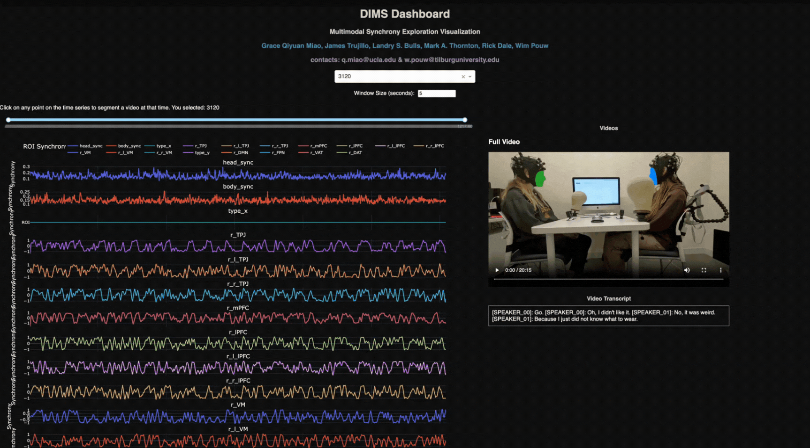

# DIMS Dashboard

*Dynamic Interaction and Multimodal Signals*

## See the moments behind your data.

What does a sudden peak in your time series correspond to? What happens before and after a meaningful transition? When multiple signals move together, what underlying process might they reflect?

The **DIMS Dashboard (Dynamic Interaction and Multimodal Signals)** is an open-source, interactive platform for exploring, visualizing, and interpreting multimodal dynamic data (e.g., neural activity, physiological responses, body movements, facial expressions, eye gaze, and linguistic behaviors). By bringing quantitative time series together with synchronized video, transcripts, and annotations in a single interactive environment, DIMS helps you move seamlessly between computational patterns and the real-world phenomena they capture.

**Click on a signal. Explore the corresponding moment. Discover what your data mean.**

**[Explore a live dashboard](https://dims-network.github.io/case-demo/) | [Build your own dashboard — no coding required](https://dims-network.github.io/dims/latest/tutorial/)**

*Select any moment in your time series to instantly preview the corresponding video segment, transcript, and co-occurring signals.*

## Why DIMS?

Human experiences and interactions unfold moment by moment, across multiple modalities and timescales. Yet conventional analytical approaches often reduce these rich dynamics to averages, summary statistics, or isolated signals. In doing so, we risk overlooking the very processes we seek to understand.

Even when sophisticated computational methods identify meaningful patterns, researchers are often left with a fundamental question: **What was actually happening at that moment?**

DIMS bridges the gap between computational measurements and the phenomena they are intended to capture, opening new possibilities for scientific discovery.

## DIMS in action

Explore how DIMS has been applied to different research questions in our published methodological demonstrations:

- **Interpersonal interaction:** Exploring how fluctuations in inter-brain synchrony correspond to verbal and nonverbal engagement during conversation.
- **Media processing:** Examining how multimodal physiological responses unfold during advertisement viewing and contribute to the interpretation of emotional dynamics.

Read our publications in [*CogSci Proceedings*](https://escholarship.org/uc/item/8gg7474j) and [*Communication Methods and Measures*](https://www.tandfonline.com/doi/full/10.1080/19312458.2026.2740465) for case studies, methodological discussions, and practical tutorials.

## Who is DIMS for?

Anyone studying dynamic processes through time-series data, using qualitative methods, quantitative methods, or both.

From how people interact, learn, and move to how they think, feel, and respond to their environments, DIMS provides a shared space for examining these processes as they unfold.

DIMS works across modalities, disciplines, and methodological traditions. All you need to get started is time-aligned data, with or without video.

---

Published at **<https://dims-network.github.io/dims/>**, built from this
directory once per release — a page on the site and the file beside the code are
the same text, at the version you are reading. See [Citing DIMS](citing.md) for
the paper and the code.
